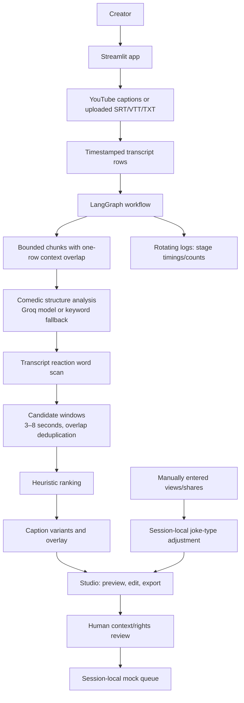

# PS-18: Comedy & Meme Clip Detection Agent

A Streamlit MVP for finding transcript-timestamped comedy moments in long-form YouTube content, ranking them with transparent heuristics, and preparing meme-style captions for human review.

> **Current scope:** transcript-first discovery. This app does not analyze audio/video for laughter, render a vertical clip, or publish to a social platform. The scheduler and audience feedback are session-local prototypes.

## Contents

- [Problem addressed](#problem-addressed)
- [Architecture](#architecture)
- [End-to-end workflow](#end-to-end-workflow)
- [Agent responsibilities](#agent-responsibilities)
- [How the MVP maps to the brief](#how-the-mvp-maps-to-the-brief)
- [Scoring](#scoring)
- [Setup and run](#setup-and-run)
- [Using the Studio](#using-the-studio)
- [Configuration](#configuration)
- [Code map](#code-map)
- [Limits and roadmap](#limits-and-roadmap)

## Problem addressed

A creator may need to scrub through hours of podcast, stream, vlog, or stand-up footage to find a few moments worth sharing. PS-18 shortens that search by analyzing available transcript text and timestamps, then presenting a ranked shortlist with evidence and source links.

Input is a YouTube URL with retrievable captions, or an uploaded transcript. Output is a list of short timestamp windows, transcript evidence, a joke-type label, a heuristic score, and suggested caption/overlay text. The creator inspects the original source, edits a meme card, and can export the results or add a reviewed moment to a mock queue.

## Architecture



Streamlit UI and the LangGraph workflow run in the same Python process. `app.py` handles input, transcript retrieval, previews, exports, and session state. `agents.py` defines a **linear graph of logical agents**, not independently deployed services. Graph state moves through the nodes and progress events stream to the UI. There is no database, task queue, media storage, or publishing backend.

A transcript row is represented as `{ "start": 282.0, "end": 284.4, "text": "..." }`. Workflow state adds chunks, structure findings, reaction clues, and candidate objects. Candidate records include timing, evidence, joke type, scores, rank, reaction status, captions, and overlay text.

## End-to-end workflow

1. **Parse input:** the app extracts a video ID from common YouTube watch, youtu.be, embed, Shorts, or live URLs. The user selects a preferred language.
2. **Retrieve transcript:** the app uses `youtube-transcript-api`, preferring the requested language and attempting generated or other available tracks if needed. Alternatively, it reads an uploaded SRT/VTT or TXT file. SRT/VTT timings are retained; TXT timings are estimates based on reading speed.
3. **Prepare transcript:** rows are packed into chunks of about 4,200 characters. The last row of a chunk overlaps into the next to retain local context. Individual text rows are capped at 500 characters for model input.
4. **Analyze comedic structure:** with `GROQ_API_KEY`, the configured Groq chat model is prompted to return up to five JSON findings per chunk with timestamps, joke type, evidence, reason, structure score, overlay, and caption variants. Without a key, on an empty model response, or on call failure, a keyword/punctuation fallback may produce weaker suggestions.
5. **Find textual reaction clues:** a deterministic scan flags transcript words like “laugh,” “haha,” “audience,” and “no way.” It does not inspect the audio or video.
6. **Generate candidate windows:** findings are clipped to transcript duration and constrained to the 3–8 second range. Invalid windows are discarded, overlapping windows are deduplicated in favor of the higher score, and the user-selected maximum limits retained results.
7. **Rank and caption:** candidates are sorted by the heuristic score. The caption node generates deadpan, hype, and meme variants and an overlay where possible; local defaults are used if model captions are unavailable.
8. **Review and export:** the Studio displays the moments, evidence, source previews, and links. The user edits caption/overlay text, chooses a sticker, exports a Markdown meme card, or downloads all moments as JSON.
9. **Prototype feedback loop:** manually entered views/shares can slightly adjust joke-type ranking in the current session. A human review checkbox is required to create a mock queue entry; no actual upload occurs.

## Agent responsibilities

| Logical node/component | Responsibility | Current boundary |
|---|---|---|
| Ingestion | Chunk supplied timestamped transcript rows and report counts/progress. | No raw media download or speech transcription. |
| Comedic structure | Find likely setup/punchline moments using Groq or fallback keywords. | Text/timestamps only; no acoustic pause or delivery analysis. |
| Reaction signal | Find reaction-related words in transcript rows. | A text proxy, not laughter detection. |
| Candidate generation | Bound windows, attach evidence/reaction status, remove overlaps. | Timestamp windows only; no MP4 extraction. |
| Shareability ranking | Sort candidates and assign ranks using the computed score. | Heuristic only; no trained model or platform performance corpus. |
| Meme caption | Create deadpan, hype, meme captions and overlay suggestions. | Text/card only; no timed video overlay/sticker composition. |
| Orchestrator | Run nodes sequentially through LangGraph and stream status. | No independent agents or publish retry workflow. |
| Studio | Review, preview source, edit text, export JSON/Markdown. | Streamlit interface/session state. |
| Mock publishing queue | Record destination, title, time, and source timestamps after review. | No API calls or uploads. |
| Audience feedback | Apply small joke-type adjustment based on entered shares/views. | Manual and session-local, not persistent or learned across sessions. |

## How the MVP maps to the brief

| Problem-statement capability | MVP behavior | Coverage |
|---|---|---|
| Ingest long-form video/audio | Retrieves YouTube captions or accepts transcript files. | Partial: transcript ingestion, not media ingestion. |
| Detect laughter/reactions | Flags laughter and reaction words in transcript. | Partial: no audio/video analysis. |
| Detect joke structure/timing | Model reviews timestamped text for likely comedy moments. | Partial: no acoustic pause/delivery analysis; human review needed. |
| Isolate 3–8 second candidates | Validates timestamp windows, removes overlaps, limits output count. | Implemented for timestamps; does not create media clips. |
| Rank shareability | Ranks by structure score and a transcript reaction bonus. | Partial: transparent heuristic, not calibrated virality prediction. |
| Generate meme captions/overlays | Produces three styles and editable overlay/card. | Implemented for text; no video rendering or timed overlay. |
| Vertical format and loop optimization | No clip renderer or loop editor. | Not implemented. |
| Scheduled publishing | Queue UI records a selected destination/time. | Mock only; no platform API or actual schedule. |
| Learn audience preferences | Manual joke-type views/shares slightly adjust ranking. | Session-local prototype; no persistence or analytics import. |
| Optional human checkpoint | Requires review checkbox before mock queue insertion. | Implemented for simulation only. |
| Retry failed publishing | No publisher exists to retry. | Not implemented. |
| Live demo, joke types, caption variants, before/after | Shows candidates and caption styles with timestamp previews. | Partial: not real time; no rendered before/after clip. |
| Cross-platform caption adaptation | Queue offers platform labels but does not adapt text. | Not implemented. |
| Rights and safety pre-check | Manual review reminder and acknowledgement. | No automated music, rights, or sensitive-content analysis. |
| Weekly Best Of compilation | No compilation feature. | Not implemented. |

The MVP tackles the core time-saving problem by using transcript analysis to direct a human to likely moments in the original video. It does not claim to identify every joke or predict virality. Results are candidates for review, not publication-ready video clips.

## Scoring

The candidate score is computed as:

```text
score = min(100, round(structure_score * 0.85 + (12 if transcript_reaction_cue else 0)))
```

The structure score is provided by the model (or defaults to 50 if absent) and is clamped to 0–100. A matching transcript reaction cue adds 12 before capping the result. Candidates are sorted by this score. Once there are at least three feedback records, the UI may apply a joke-type adjustment from -8 to +8 if that type has at least two records. This adjustment uses manually entered shares/views and only exists in session state.

Fallback keyword matches are weak signals. The score is useful for sorting, not an objective humor judgment or performance guarantee.

## Setup and run

Run these commands from this application folder.

Requirements: Python 3.10+, internet access for transcript retrieval/model calls, and an optional Groq API key for model-assisted analysis.

### Windows PowerShell

```powershell
py -m venv .venv
.\.venv\Scripts\Activate.ps1
pip install -r requirements.txt
Copy-Item .env.example .env
```

Edit `.env` and set your own `GROQ_API_KEY`, then run:

```powershell
streamlit run app.py
```

Open the local address Streamlit prints. Stop the server with `Ctrl+C`.

### macOS/Linux

```bash
python -m venv .venv
source .venv/bin/activate
pip install -r requirements.txt
cp .env.example .env
# Edit .env and set your own GROQ_API_KEY
streamlit run app.py
```

## Using the Studio

1. Paste a YouTube URL and choose a transcript language.
2. If captions cannot be retrieved, upload SRT/VTT for source timing, or TXT for approximate timings.
3. Set the target moment duration (3–8 seconds) and maximum retained moments in the sidebar.
4. Start analysis and follow the streamed agent/chunk progress.
5. Review ranked moments and transcript evidence. Open a source timestamp or inspect the selected window in Meme Studio.
6. Edit caption/overlay, pick a reaction sticker, export a Markdown card, or download candidate data as JSON.
7. Optionally acknowledge manual review and add a simulated queue item. It does not publish anything.
8. Enter creator feedback manually to view the session-local score adjustment.

## Configuration

| Variable | Purpose | Default |
|---|---|---|
| `GROQ_API_KEY` | Enables Groq analysis and caption generation. | Empty; fallback behavior is used. |
| `GROQ_CHAT_MODEL` | Groq model identifier. | `llama-3.3-70b-versatile` |
| `GROQ_TPM_BUDGET` | Approximate rolling token reservation for pacing calls. | `6500` |
| `YOUTUBE_CHANNEL_ID` | Label shown on mock queue entries. | Empty/not configured. |

The app does not require a YouTube API key or OAuth credentials. Transcript retrieval is through the third-party `youtube-transcript-api`. A channel ID only labels a mock record; it does not grant upload permissions.

## Code map

| File | Purpose |
|---|---|
| `app.py` | Streamlit UI, URL parsing, transcript retrieval/file parsing, player preview, exports, queue, and feedback. |
| `agents.py` | LangGraph state/nodes, chunking, Groq calls, fallbacks, candidate validation/scoring, captions, progress, and logs. |
| `requirements.txt` | Python dependencies. |
| `.env.example` | Safe template for local configuration; copy to `.env`. |
| `logs/ps18.log` | Rotating runtime log with stage timing/counts and error types. |

## Operational notes

- Long transcripts require multiple model calls. `GROQ_TPM_BUDGET` paces requests using approximate token reservations; provider accounting may differ.
- Failed or empty model responses can fall back to keywords, improving availability but reducing precision.
- Captions may be disabled, restricted, unavailable, or blocked by the third-party retrieval library. Upload a transcript when you have one.
- Plain-text timing is estimated and must be checked against the source before editing.
- Candidate, queue, and feedback state is held in the current Streamlit session, not a database.
- Logs rotate at 2 MB and keep up to three backups. The code avoids logging transcript text, prompts, and API keys.
- Use source material you are authorized to analyze and repurpose. The review checkbox is not an automated rights check or legal advice.

## Limits and roadmap

Implemented today: transcript retrieval/upload, chunking, model/fallback discovery, text-only reaction clues, short timestamp candidate windows, overlap removal, heuristic ranking, caption variants, editable card preview, source links, JSON/Markdown exports, mock queue, and session-local feedback.

Not implemented: raw audio/video ingestion, speech-to-text, audio laughter or visual reaction analysis, delivery/pause analysis, MP4 trimming/rendering, vertical reframing, loop optimization, timed stickers, rights/safety automation, live publishing, persistent scheduler, platform-specific rewriting, automatic analytics, durable creator learning, and weekly compilations.

A path toward the full brief is to add authorized media ingestion and word-level transcription; audio reaction analysis; an evaluated ranking model; a rendering pipeline for precise vertical clips and loops; persistent creator settings and analytics; then authorized publishing with retries/idempotency and a real human approval gate. Rights/safety checks and compilation assembly can follow as distinct stages. These are roadmap items, not current behavior.
